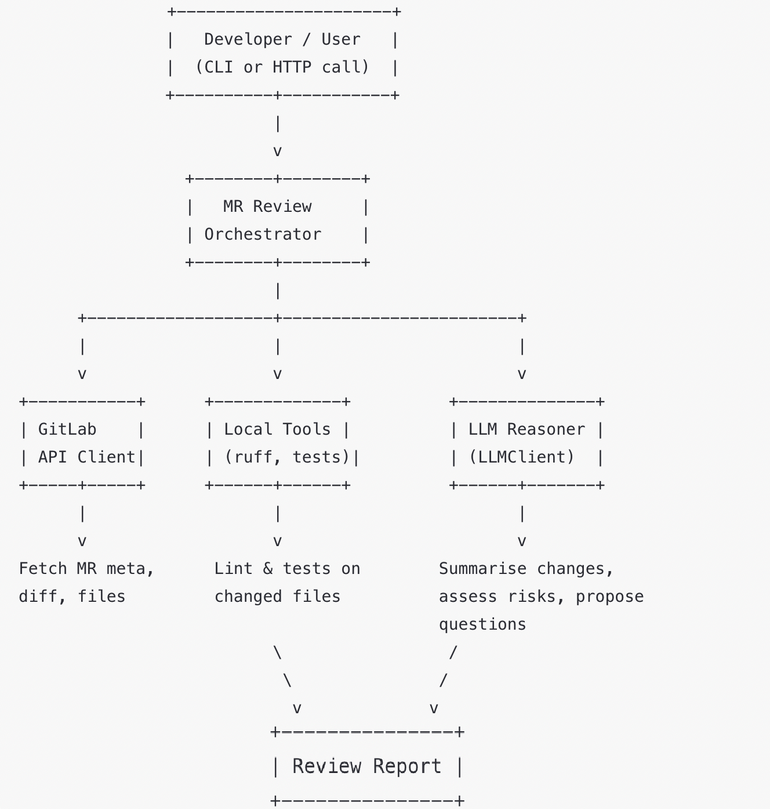
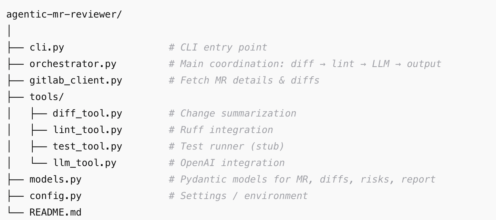

# agentic-mr-reviewer

### Getting started - Agectic Gitlab Merge Request Reviewer.

We built a small agentic AI system **agentic-mr-reviewer** that helps review GitLab Merge Requests (MRs) by combining existing tooling (linters, tests, diff inspection) with LLM-based reasoning. This could improve review quality and consistency, especially on large or repetitive MRs, and act as a productivity support tool for reviewers. The tooling could be extended into CI pipelines as an optional pre-review step.
The goal is to provide a reviewer style assistant that summarises what an MR changes, runs and interprets lint/tests, and highlights potential issues or questions for the human reviewer.

It performs:

- Git diff analysis
- Linting (Ruff)
- Basic test execution
- LLM-powered contextual review
- Risk profiling
- Suggested questions for the author
- Markdown output for GitLab CI comments
- Duplicate-comment detection + comment updates

The reviewer can run manually via CLI or automatically inside GitLab CI for every new or updated MR.
 
### Architecture

### Scope & Approach

The system:
- Integrates with GitLab’s API to fetch MR metadata, diffs, and changed files.
- Runs local tooling (e.g. ruff, pytest) on the relevant paths.
- Uses a small set of explicit tools (e.g. get_diff, run_linter, run_tests, summarise_changes) exposed to an LLM-powered “agent” that orchestrates a short review workflow.
- Produces a structured “review report” (summary, potential risks, suggested questions) that a developer can use as input, assisting in reviewing the code.
- Provides MR comment automation. Outputs GitLab-friendly Markdown. Wraps sections in 
 folding blocks. Posts MR review as a GitLab comment. Updates the same comment on each run (no duplicates!)
- Provides GitLab CI integration. Provides Plug-and-play .gitlab-ci.yml or reusable template.

### Project structure

